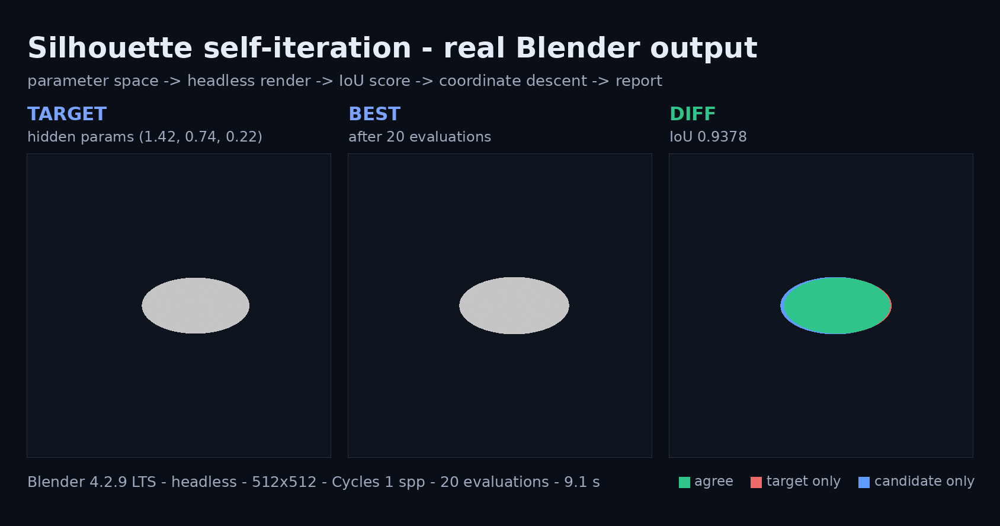

# blender-automation-skill

> **AI Skill + MCP toolkit for agent-driven headless Blender modelling.**
> 参数空间 → 无头渲染 → 量化打分 → 搜索 → 报告，全程脚本化、可复现、可审计。

[](https://github.com/LUgABeEEE/blender-automation-skill/actions/workflows/ci.yml)
[](LICENSE)
[](pyproject.toml)
[](SKILL.md)

`blender-automation-skill` 把「用 Blender 反复调模型」做成可复现的工程流程：
**参数空间 → 无头渲染/求值 → 打分 → 搜索 → 报告**。它不绑定具体模型，也不依赖 Blender 的 GUI，
所有几何工作都在一个可审计的脚本里完成；Blender 只作为受内存/超时约束的子进程被调用。

- **引擎**：`blender-automation-skill`（Python 包 `model_loop`，稳定 API；`model-loop` 命令仍是可用别名）
- **对外形态**：CLI + **MCP server** + [SKILL.md](SKILL.md)——任何 agent 都能调用

## 在任何 agent 里调用（MCP）

```bash
pip install "blender-automation-skill[mcp]"

# Claude Code
claude mcp add blender -- blender-automation-skill-mcp

# Codex
codex mcp add blender -- blender-automation-skill-mcp
```

任意 MCP 客户端（Cursor / DSH / 自研 agent）用同一份配置：

```json
{
  "mcpServers": {
    "blender": { "command": "blender-automation-skill-mcp", "args": [] }
  }
}
```

| 工具 | 作用 |
|---|---|
| `blender_capabilities` | 探测 Blender 路径/版本、本机 CPU 与内存 |
| `blender_bench` | 冷启动、渲染、布尔耗时与峰值 RSS |
| `blender_run_script` | 用一个 JSON 参数跑一次 Blender 脚本，回传产物 |
| `blender_optimize` | 对目标剪影做坐标下降搜索（最大化掩膜 IoU） |
| `blender_demo` | 内置剪影自迭代示例，零资产即可跑通 |
| `blender_report` | history.json → 单文件 HTML 报告 |

工具都返回 JSON，缺 Blender / 参数非法时返回 `{"ok": false, "error": ...}` 而不是抛异常。

## 快速开始（CLI）

```bash
python -m pip install -e ".[dev]"

# 1) 看看这台机器跑 Blender 是什么水平
blender-automation-skill bench --blender /path/to/blender --out out/bench
#    -> out/bench/bench.html / bench.json

# 2) 跑一个完整的自迭代示例（无需任何模型资产）
blender-automation-skill demo --blender /path/to/blender --out out/demo
#    -> out/demo/report.html（迭代曲线 + 最佳参数 + 目标/最佳渲染对比）

# 3) 测试
pytest -q
```

一次实测（headless Ubuntu、16 核 CPU、无独显、Blender 4.2.9 LTS）：

```
cold start          0.23 s
render 1024²/1spp   0.03 s
render 1024²/16spp  0.26 s
render 1024²/64spp  0.98 s
EXACT boolean       0.23 s（29k 顶点）
peak child RSS    454 MB
```

## 真实输出（本机实测，非示意图）



`demo` 把「隐藏参数」渲染成目标剪影，再让坐标下降只凭 IoU 把它找回来：目标 `(1.42, 0.74, 0.22)` 只用于渲染参考图，
搜索从 `(1.0, 1.0, 0.0)` 出发，20 次评估收敛到 `(1.45, 0.76, 0.19)`，掩膜 **IoU 0.9378**（512²、1 spp、全程 9.1 s）。
左：目标剪影；中：最佳候选渲染；右：像素级差异（绿=重合，红=只属于目标，蓝=只属于候选）。
这三张图（`docs/assets/demo-*.png`）与 `out/demo/report.html` 都由 `blender-automation-skill demo` 现场生成，仓库里不存任何预置渲染。

## 为什么

手调 Blender 模型有三个反复出现的问题：

1. **不可复现**——这次调出来的效果，下次说不清是哪组参数、哪个版本；
2. **机器不可控**——一个大网格布尔能把整台机器吃满，和别的服务一起被 OOM；
3. **评估靠眼睛**——没有量化指标，就谈不上"更好"，更谈不上自动迭代。

这个项目对应给出三件东西：**建模工作流**（脚本化、确定性的场景与导出约定）、
**机器调优**（基准 + 内存上限 + 串行 + 超时）、**自迭代闭环**（缓存、预算、搜索、报告）。

## 三个支柱

| 支柱 | 内容 | 入口 |
|---|---|---|
| 建模工作流 | `--factory-startup` 无头运行、单位与导出约定、场景可重建 | [docs/modeling-workflow.md](docs/modeling-workflow.md) |
| 机器调优 | 冷启动/渲染/布尔基准、地址空间上限、flock 串行、超时、峰值 RSS | [docs/machine-tuning.md](docs/machine-tuning.md) |
| 自迭代闭环 | 参数空间、评估器契约、内容哈希缓存、预算、坐标下降、HTML 报告 | [docs/self-iteration.md](docs/self-iteration.md) |

## 作为库使用

```python
from model_loop import BlenderConfig, Evaluation, Loop, ParamSpec, SearchSpace, render_report

space = SearchSpace(
    [
        ParamSpec("width", 0.4, 2.0, default=1.0),
        ParamSpec("height", 0.3, 1.6, default=1.0),
    ]
)


def evaluate(params, workdir):
    """任意求值：跑一次 Blender、跑一次求解器、或纯函数。"""
    score = (params["width"] - 1.4) ** 2 + (params["height"] - 0.7) ** 2
    return Evaluation(params=params, score=score)


loop = Loop(space, evaluate, "out/my-run", budget=60)
result = loop.run_coordinate_descent(rounds=4)
result.save("out/my-run/history.json")
render_report(result, "out/my-run/report.html")
```

评估器拿到的是**普通 dict**，返回 `Evaluation(score=..., metrics=..., artifacts=[...])`；
循环负责缓存（内容哈希）、预算、历史与报告。评估器内部怎么实现都行——见
[examples/custom_evaluator.py](examples/custom_evaluator.py)。

MCP 侧的脚本契约（`blender_run_script` / `blender_optimize`）：

```
blender --background --python <script> -- <params-json> <png-out> [resolution]
```

## 目录

```
src/model_loop/
  params.py      参数空间（边界、采样、量化、内容哈希）
  search.py      坐标下降 / 随机搜索（预算可中断）
  metrics.py     掩膜 IoU / RMSE / 质心 / 包围盒
  blender.py     受控的 Blender 子进程（内存上限、锁、超时）
  pipeline.py    Loop：缓存、预算、历史、结果序列化
  report.py      单文件 HTML 报告（内联 SVG + base64 图）
  demo.py        剪影自迭代示例（真实 Blender 渲染）
  bench.py       机器基准（渲染 / 布尔 / 冷启动 / RSS）
  cli.py         命令行入口
  mcp_server.py  MCP server（stdio，6 个工具）
tests/           68 个单测（不需要 Blender）
SKILL.md         agent skill 说明（Claude Code / Codex / DSH 通用）
examples/mcp.json  MCP 客户端配置示例
examples/mcp-clients/  各 agent 客户端配置样例（Claude Code / Codex / Cursor / DSH）
docs/            四篇指南 + 单文件 HTML 导览
```

## 边界

- **不做建模本身**：几何由你的 Blender 脚本决定，这里负责调度、评估与迭代。
- **不做分布式**：串行是默认策略（一块 GPU / 一份内存）。要并行请自己在评估器外层做。
- **不打包模型资产**：示例是程序化生成的，仓库里没有二进制模型。
- **不做沙箱**：别用它执行不可信的 Blender 脚本，这类脚本请放进容器/VM。
- **不依赖 GPL 代码**：只调用 Blender 可执行文件；本项目代码为 MIT。

## 文档

- [建模工作流](docs/modeling-workflow.md)：脚本边界、确定性、单位、导出与命名
- [机器调优](docs/machine-tuning.md)：基准、内存、串行、超时、失败模式
- [自迭代闭环](docs/self-iteration.md)：目标函数、参数空间、预算、收敛与复现
- [MCP 接入](docs/mcp.md)：Claude Code / Codex / Cursor / DSH 的接入配置、6 个工具逐参数说明与常见错误
- [HTML 导览](docs/index.html)：一页看完结构、闭环与命令
- [SKILL.md](SKILL.md)：给 agent 看的调用说明与红线

## 贡献

见 [CONTRIBUTING.md](CONTRIBUTING.md)。安全问题见 [SECURITY.md](SECURITY.md)。

## 许可证

[MIT](LICENSE) © 2026 LUgABeEEE
